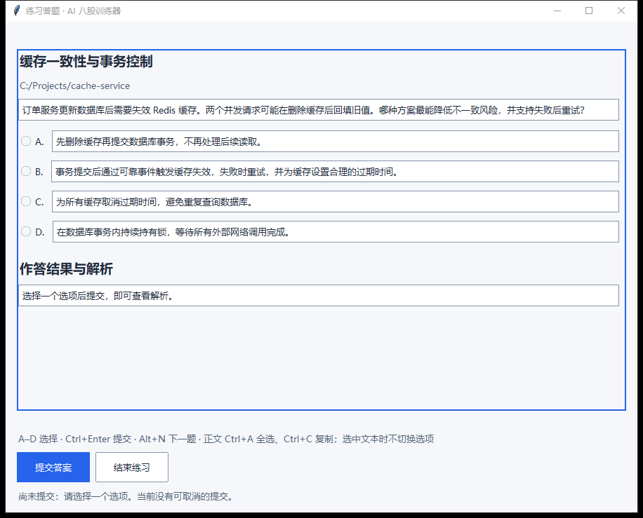

# AI 八股训练器

**把日常代码改动，变成贴近项目的面试练习。**

AI interview practice from your code changes.

后端开发结构与兼容约束见 [架构说明](docs/ARCHITECTURE.md)，分层重构的实际验收见 [第 8 步记录](docs/BACKEND_REFACTOR_STEP8.md)。

**v0.5.1 当前桌面版采用 Electron + React + TypeScript + Vite**，Python 继续负责代码监听、知识点匹配、AI 出题审核、题库构建和 SQLite 学习记录。当前桌面使用与开发说明的入口是 [docs/ELECTRON_DESKTOP.md](docs/ELECTRON_DESKTOP.md)；旧版 Tk 兼容说明集中在本页末尾的[归档区](#旧版-tk-兼容说明归档)。

面向正在写项目、准备技术面试的开发者：监听项目变化，匹配题库知识点，生成贴近代码场景的 AI 情景题；作答后查看解析，按计划复习。

**[下载 Windows 安装版 · v0.5.1](https://github.com/bugan9527-tech/bagu-trainer/releases/download/v0.5.1/BaguTrainer-0.5.1-windows-x64-Setup.exe)** · [便携 ZIP](https://github.com/bugan9527-tech/bagu-trainer/releases/download/v0.5.1/BaguTrainer-0.5.1-electron-windows-x64.zip) · [最新发布与校验文件](https://github.com/bugan9527-tech/bagu-trainer/releases/latest) · [三步上手](#三步上手)

适用于 Windows x64。安装版和便携版无需安装 Python、Node.js 或 Tcl/Tk；首次使用需要下载题库来源并配置模型 API，模型请求可能产生服务商费用。



*实际桌面界面；截图使用自编演示题与模拟作答结果，不含个人项目、真实学习记录或模型调用。*

`代码改动 → 知识点匹配 → AI 情景出题 → 作答解析 → 间隔复习`

## 三步上手

1. **下载并启动**：下载安装版后启动“AI 八股训练器”；便携用户完整解压 ZIP，再运行 `BaguTrainer.exe`。
2. **准备题库与模型**：在“题库管理”选择来源并“下载并构建”；在“模型配置”填写 API 信息，测试连接后“保存配置”。
3. **添加项目并开始练习**：在“监听项目”添加代码目录并“保存并应用”。程序建立基线后，后续代码改动在匹配到知识点且生成成功时进入“练习中心”。

[当前 Electron 桌面说明](docs/ELECTRON_DESKTOP.md) · [题库来源与许可](interview-banks/README.md) · [AI 出题规则](AI_QUIZ_POLICY.md) · [常见问题](#常见问题)

已有用户升级：正常退出后直接运行新版安装包，保留个人配置和学习记录；不要先完整卸载。安装、便携和数据目录的当前行为见 [Electron 桌面说明](docs/ELECTRON_DESKTOP.md#安装版)。

## 当前版本与旧版 Tk

- 当前版本 `0.5.1`，版本来源为 `package.json` 和 `bagu_trainer/version.py`。
- 当前桌面是 Electron + React + TypeScript + Vite；主窗口七页，练习使用唯一的独立答题窗口。
- Python 引擎目录 `bagu_trainer/` 仍包含旧版 Tk 兼容入口，用于兼容测试和 v0.4.x 发布工作流；Electron 运行不导入 Tk 窗口。
- `FIRST_USE.md`、`DESKTOP_MODE.md`、`STARTUP.md`、`PORTABLE_README.md` 等根目录文档只适用于 0.4.x Tk 兼容版，已在本页末尾标注归档。当前使用不要执行其中的 `scripts/start_desktop.py`、`--install-startup` 或 `--migrate-from`。

## 安装版、便携版与源码版

### 安装版（普通用户推荐）

打开 [Release 页面](https://github.com/bugan9527-tech/bagu-trainer/releases)，在 Assets 下载
`BaguTrainer-<版本>-windows-x64-Setup.exe` 和同名 `.sha256`，核对摘要后双击安装，再从开始菜单启动。

- 中文安装向导，只安装程序；当前用户安装，默认无需管理员权限，可选桌面快捷方式。
- 默认程序目录：`%LOCALAPPDATA%\Programs\BaguTrainer\`。
- 个人数据目录：`%LOCALAPPDATA%\BaguTrainer\`，升级时保留。
- 安装完成后直接进入七页工作台，在“题库管理”“模型配置”“监听项目”页完成准备；没有强制先后顺序。
- 主动完整卸载会清除受管数据及本机 Windows 凭据；**不能把卸载作为保留数据的升级步骤**。

安装器与 Electron 载荷的当前结构、构建边界和未验证范围见 [Electron 桌面说明](docs/ELECTRON_DESKTOP.md) 与 [Electron 迁移验证](docs/ELECTRON_VALIDATION.md)。`WINDOWS_INSTALLER.md` 保留 0.4.x Tk 时代的安装生命周期细节，仅作历史/共用脚本参考。

### 便携版

下载 `BaguTrainer-<版本>-electron-windows-x64.zip` 及同名 `.sha256`，核对摘要后**完整解压**，双击其中的 `BaguTrainer.exe`。

必须保留根目录的 `BaguBackend.exe`、`BaguCleanup.exe`、`_internal\`、`resources\`、DLL/`locales` 和许可证文件，不要只复制主 EXE。便携版不需要安装 Python、Node.js 或 Tcl/Tk，默认与安装版共用 `%LOCALAPPDATA%\BaguTrainer\`。

升级时正常退出，完整解压新版到新目录，再运行新 EXE；不要先完整卸载。`PORTABLE_README.md` 是 0.4.x Tk 兼容版的便携说明，且被旧 Tk 构建复制为包内“使用说明”，不能当作 0.5.1 Electron 便携结构。

### 源码版（开发者）

需要 Windows x64、Python 3.10+、Node.js 22.12+。克隆仓库或解压源码 ZIP，在项目根目录执行：

```powershell
python -m venv .venv
.\.venv\Scripts\python.exe -m pip install -r requirements.txt
$env:BAGU_PYTHON = (Resolve-Path .\.venv\Scripts\python.exe).Path
npm ci
npx install-electron --no
npm start
```

- `npm start` 先执行 TypeScript 检查和 Vite 生产构建，再启动 Electron。
- 开发界面可用 `npm run dev`，仅在本机 `127.0.0.1` 开启 Vite；正式程序不启动 Vite。
- 默认使用 `.venv-build\Scripts\python.exe`（存在时）或 PATH 中的 `python`；`BAGU_PYTHON` 可指向实际解释器。
- Electron 正常学习流程不导入 Tk 窗口；完整卸载工具仍使用 Tk 确认窗口，因此源码版完整卸载、冻结 `BaguCleanup` 构建和旧版 Tk 兼容包需要 Tcl/Tk。
- 源码版也直接进入工作台，默认与安装版、便携版共用 `%LOCALAPPDATA%\BaguTrainer\`。

### 发布与验证状态

v0.5.1 的后端分层、修复和清理范围见 [本版发布说明](RELEASE_0.5.1.md)，源码清理验证见 [清理记录](docs/DEAD_CODE_CLEANUP.md)。当前版本的冻结程序与安装器验证结果以本版 Release 附件为准。

当前 `.github/workflows/windows-electron.yml` 执行 Electron 构建、核心测试、源码/冻结 EXE 验收，并上传构建 artifact；它**不创建草稿 Release**。正式发布资产由维护者在本机运行 `npm run package:zip` / `npm run package:installer`，核对 SHA-256 后上传。`.github/workflows/windows-portable.yml` 是 **v0.4.x 旧 Tk 兼容工作流**，仍包含旧版草稿 Release 步骤，不能与 Electron 工作流混用。

当前 Electron 验证记录见 [docs/ELECTRON_VALIDATION.md](docs/ELECTRON_VALIDATION.md)：源码和冻结 EXE 已使用隔离合成数据验证七页导航、草稿恢复、答题、重复提交保护、历史与重练、中文路径及首次使用；没有用真实个人模型账号执行付费连接测试或真实 AI 出题，也没有执行真实 Windows 安装、覆盖升级、登录后自启动或完整卸载。产物未签名；构建/解包审计不等于生命周期验收通过。

历史 Tk 版本的记录保留在原文档中，版本和未验证范围必须一并阅读：[历史验证记录](VALIDATION.md) 包含旧向导流程、v0.3.0 构建及 0.1.0 → 0.2.0 隔离夹具结果；0.4.0 本地产物路径修复证据 `validation/artifact-path-fix-20261025/RESULTS.md`（未随仓库或发布包分发）记录 148 项相关回归通过，但完整冻结 UI 验收仍报 `No acceptance milestones completed`；0.4.0 的 [真实 Setup 生命周期验收](INSTALLED_LIFECYCLE_ACCEPTANCE.md) 已补齐脚本和说明，但当前六项真实安装场景均未执行。这些历史事实不自动适用于 0.5.1 Electron。

## 功能与边界

- 通过主窗口添加监听项目；比较监听开始后的文件快照，即使改动已自动提交到 Git 也能检测。
- 文件稳定约 15 秒后匹配知识点，新题更新练习中心待答徽标，不抢走当前阅读或输入页面；人工修改也可能触发。
- 在练习中心选题，于独立答题窗口选择 A–D、提交答案并查看解析，作答及复习计划保存到本地 SQLite。
- 切页保留当前题目、未提交选择和任务状态；`Ctrl+R` 打开或恢复答题窗口（表单输入时不拦截）。待答列表只读，明确进入某题时才交付该题。
- 主窗口“答题记录”按每次作答回顾历史，支持正误、项目和知识点/题干关键词筛选，每页 20 条；已移除项目及旧题库的题目仍从快照查看。时间按本机时区显示。
- 历史详情可“重新练习本题”：复用合格的 AI 快照，不调用模型，复用独立答题窗口；同一来源作答未完成的重练复用题号，提交后新增一次记录。旧快照缺失字段或不符合准入规则时解释原因并禁用重练。
- 普通切页不停止监听、不重建基线；项目实际保存后串行应用，未变化项目基线保留。题库构建、模型测试和保存不因隐藏页面取消。

程序不保证每次改动都有题。未匹配知识点、缺少可靠来源、模型接口不可用或上下文重复时，可能没有题目。代码改动稳定只是触发时机的近似判断，不能精确识别 AI 任务何时结束。

## 环境要求

以下 Python 和命令行步骤供开发者从源码运行；下载安装版或便携版的普通用户无需执行。

| 项目 | 要求 |
| --- | --- |
| 操作系统 | Windows x64 桌面；安装版/便携版支持当前用户登录自启动 |
| Python | 仅源码运行和构建需要 3.10 或更高；安装版和便携版已内置运行库 |
| Node.js | 仅 Electron 源码开发与构建需要 22.12 或更高；安装版和便携版无需安装 |
| Tcl/Tk | Electron 正常学习流程不需要；源码版完整卸载、构建冻结 `BaguCleanup` 和旧版 Tk 兼容包时需要 |
| 下载题库 | 桌面内置 HTTPS ZIP 下载和构建，无需 Git 或外部构建命令 |
| 模型接口 | 支持 `/chat/completions`、Bearer Key 认证和文本 JSON 输出的兼容接口 |
| 网络 | 首次安装依赖、下载来源及调用远程模型时需要连接相应服务 |

运行时依赖见 [requirements.txt](requirements.txt)，测试依赖见 [requirements-dev.txt](requirements-dev.txt)，便携包构建依赖见 [requirements-build.txt](requirements-build.txt)。

历史 MCP 配置、演示和重复生成物的清理范围及保留理由见 [清理记录](CLEANUP_REPORT.md)。

## 在工作台完成准备（三种运行方式通用）

### 1. 题库管理

打开侧栏“题库管理”，从 [来源清单](interview-banks/README.md) 选择来源并阅读许可声明，点击“下载并构建”。程序通过 HTTPS 下载清单固定 commit 的 ZIP，安全解压后依次完成提取、导入、标签和概念构建。页面显示阶段进度，可设置“任务总时限（秒）”、点击“取消构建”或“仅重试失败项”；不抓取 GitHub Issues。

源码版和便携版都将本机文件放入 `%LOCALAPPDATA%\BaguTrainer\`；下文运行数据相对该目录。成功后使用 `data/banks/<版本>/` 下的完整题库，通过原子指针切换；已有 `data/questions.json` 和学习数据库保持原样。已有可用题库的用户可跳过下载。流程、接口及发布范围见 [QUESTION_BANK.md](QUESTION_BANK.md) 和 [BANK_BUILD.md](BANK_BUILD.md)。

### 2. 模型配置

打开侧栏“模型配置”，填写：

| 字段 | 填写方式 |
| --- | --- |
| 接口地址 | 服务商提供的 API 基础地址，通常包含 `/v1`，不包含末尾的 `/chat/completions` |
| 模型名称 | 服务商为你的账户提供的实际模型标识 |
| API Key | 该接口的访问 Key；留空可沿用已有 Key，输入框不回填明文 |
| 超时（秒） | 大于 0 且不超过 120 秒；新题的生成与关联审核共用这一预算 |

程序会在接口地址后追加 `/chat/completions`。主动点击“测试连接”会在后台发送一个小请求，可能产生服务商计费；测试成功后点击“保存配置”。测试失败后可点击“重新测试”，进行中可点击“取消测试”。Key 写入现有 Windows 凭据管理器并回读确认，配置文件不保存 Key 明文。连接成功不保证模型一定能生成符合要求的题目。修改任一表单参数后需要重新测试，保存后即时生效。

无需先复制 `config.example.json`。在模型页面保存时会在用户数据目录创建 `config.json`。`config.example.json` 中的空 `trae_home` 表示使用当前用户的 `.trae-cn`，空 `project_roots` 会使工作台显示准备未完成，需在“监听项目”页显式添加项目；相对 `db_path` 按用户数据目录解析，与安装目录和终端所在目录无关。如已有环境变量 `BAGU_LLM_API_KEY`，它优先于凭据管理器中的 Key；排查旧 Key 或迁移时参见 [KEY_MIGRATION.md](KEY_MIGRATION.md)。

### 3. 监听项目

打开侧栏“监听项目”，点击“添加项目”选择实际代码目录，再点击“保存并应用”。目录失效时可移除后重新添加有效目录并保存，至少保留一个可读取的项目。三个条件齐全后会在原窗口加载引擎；未刷新或加载失败时，在“工作台”点击“重新检查”。

### 4. 在独立答题窗口作答

1. 在监听项目中修改并保存与题库知识点相关的源码，等待文件稳定约 15 秒及后续匹配、模型请求。
2. 生成成功后只更新待答徽标及提示，不自动切页或打开独立题目窗口。打开“练习中心”，选中待答列表中的题目后点击题目行或“进入本题”，打开唯一的非模态答题窗口；也可从工作台“继续练习”（`Ctrl+R`）恢复练习。
3. 在答题窗口选择 A–D，点击“提交答案”（`Ctrl+Enter`），查看判分、正确答案和解析。“下一题”（`Alt+N`）保留未提交草稿；没有下一题时“结束练习”隐藏窗口。关闭窗口也只隐藏，提交中的保存继续，重新打开可恢复结果。主窗口始终可操作。答题记录和复习计划保存到本机数据库。

添加项目或启动程序时会先建立基线，旧改动不会立即当作新任务。模型请求和扫描还会增加等待时间。监听不依赖未提交的 Git 差异，避免自动提交或过大的历史差异掩盖新修改。未命中知识点时，窗口会显示题库数量及“未调用 AI”；日志记录匹配、重复跳过和生成结果的数量，不记录代码正文。题库构建同时导入问句和普通知识点标题；早期仅导入问句而题量很少的本机题库，需要重新构建。

工作台“暂停监听”/“恢复监听”作用于全部项目，暂停时仍可主动练习已有题目。快捷键：`Ctrl+R` 打开或恢复答题窗口；答题窗口 `A`–`D` 选择、`Ctrl+Enter` 提交、`Alt+N` 下一题，表单输入时不拦截。关闭主窗口即开始安全退出，取消可取消任务并等待写入完成；再次运行启动入口会唤起已有实例。

启动的准备检查不下载题库、不自动测试模型；就绪后才加载引擎。缺项或引擎加载失败时仍保留七页主窗口，登录自启动使用同一个最小化窗口，可从任务栏恢复。

### 缺配置、空题库与损坏配置的恢复

- 缺题库：在“题库管理”选择来源并“下载并构建”。删除最后一个来源后仍留在主窗口，监听与练习停用；重新构建后恢复。删除时确认的关联记录不会因重新下载而自动恢复。
- 缺模型或 Key：在“模型配置”补全参数，主动“测试连接”成功后“保存配置”。环境变量中的旧 Key 需先修正。
- 缺项目或目录失效：在“监听项目”修正目录并“保存并应用”，再查看工作台准备状态。
- `config.json` 损坏或不可读：从“应用设置”查看个人数据目录，退出程序并备份文件，修复 JSON 格式或权限后重启。程序不会用默认配置覆盖坏文件；不要删除唯一的数据副本来绕过检查。
- 引擎加载失败：检查工作台提示及 `logs/desktop.log`，修复依赖、目录或权限后点“重新检查”。

## 登录后自动启动

在“应用设置 → 登录后启动”启用或取消。快捷方式指向当前安装的 `BaguTrainer.exe`，参数为 `--background`；登录后窗口最小化启动，可从任务栏恢复。

- 仅打包后的安装版/便携版支持该设置；源码运行时复选框不可用。
- Electron 主进程只处理 `--background`；`--install-startup` / `--uninstall-startup` 是旧版 Tk 入口，当前 Electron 不识别。
- `scripts/install-startup.ps1` 服务于旧版 Tk 源码启动，不是 Electron 自启动步骤。
- 移动程序目录后重新启用一次；取消自启动不会终止正在运行的程序，也不会删除学习记录。

### 换目录或换电脑

当前 Electron 没有 `--migrate-from`，也没有“迁移旧数据”按钮。先退出所有训练器副本，再按以下方式处理：

1. 备份 `%LOCALAPPDATA%\BaguTrainer\`。
2. 在新位置安装或完整解压新版程序，把备份复制到新用户的同一数据目录。
3. 重新在“监听项目”核对绝对路径，在“模型配置”重新保存 API Key；Windows 凭据不随目录复制。
4. 如需登录自启动，在新位置重新启用。

旧版 Tk 的 `--migrate-from "旧目录"` 和“迁移旧数据”向导仅适用于 0.4.x 兼容版，不能用于当前 Electron。详见本页归档区。

## 升级、修复与完整卸载

安装版正常退出后运行新版或同版 Setup，在原安装位置升级/修复，保留用户数据和凭据。便携版退出后使用新版完整目录；源码版更新代码、依赖后从同一用户数据目录启动。三种方式均不要通过“先完整卸载”来升级保留数据。

主动完整卸载：打开“应用设置”，点击“卸载应用并清除全部数据…”，核对范围后点击“确认退出并进入完整卸载”，在独立 `BaguCleanup.exe` 工具中点击“确认完整卸载 / 重试”。安装版也可从 Windows“已安装的应用”进入卸载。完整卸载清除受管题库、历史、配置、日志及本机 API 凭据；安装版和便携版可能共用这些数据，其他副本也会受影响。清理不整体删除监听项目、源码仓库、共用目录或其他副本的程序，不代表吊销服务商后台 Key。失败保留程序或重试入口，但不保证恢复已经清除的数据。

当前 Electron 安装/卸载说明见 [docs/ELECTRON_DESKTOP.md](docs/ELECTRON_DESKTOP.md)；安装器共用生命周期和 0.4.x 历史细节见 [WINDOWS_INSTALLER.md](WINDOWS_INSTALLER.md)。

## 数据与隐私

- 模型出题会向你配置的接口发送经过筛选和脱敏的项目上下文片段及题库来源正文。选择服务商时需要考虑自己项目的数据使用要求。
- 文件采集受项目白名单及敏感文件排除规则限制；会话摄取默认关闭。
- 新保存的 API Key 进入系统凭据管理器，本机配置不保存新 Key 明文。
- 用户数据根目录为 `%LOCALAPPDATA%\BaguTrainer\`；学习记录默认位于其 `data/trainer.db`，进程运行文件在 `runtime/`，滚动日志在 `logs/`。程序目录可只读。
- 本机配置、学习数据库、运行认证信息及完整题库均已通过 `.gitignore` 排除。手工制作发布附件时仍需遵守 [题库发布范围](QUESTION_BANK.md)。

## 常见问题

| 现象 | 排查方式 |
| --- | --- |
| 找不到 `python` 或 `git`（源码运行） | 确认对应程序已安装且位于 PATH，重新打开终端后检查版本 |
| 缺少 `keyring` | 用启动程序的同一解释器执行 `-m pip install -r requirements.txt` |
| Electron 提示“无法启动 Python 引擎” | 检查 `BAGU_PYTHON` 是否指向安装了依赖的解释器，查看 `%LOCALAPPDATA%\BaguTrainer\logs\desktop.log`；源码版可先运行 `npm start` 复查 |
| 便携版提示缺少运行文件 | 必须完整解压，保留 `BaguBackend.exe`、`BaguCleanup.exe`、`_internal\` 和 `resources\` |
| 提示题库不存在或已删除最后来源 | 在“题库管理”选择来源并“下载并构建”，再到工作台检查就绪状态 |
| 来源下载失败 | 检查 HTTPS 网络及系统代理；瞬时错误会自动重试，也可在窗口重新尝试 |
| HTTP 401 / 404 / 429 | 分别检查 Key/授权、基础地址与模型路径、额度及请求限制；环境变量中的旧 Key 可能覆盖新保存的 Key |
| 模型连接超时或题目生成失败 | 检查接口网络、超时设置、模型标识，以及是否支持要求的 JSON 输出 |
| 修改代码后没有待答题 | 查看练习中心徽标；确认监听未暂停、修改发生在基线建立之后，检查项目范围、来源正文及模型状态 |
| 导入提示题量减少超过 5% | 数据保护已生效；在独立目录构建新来源，保留原题库和学习数据 |

## 开发与验证

当前 Electron 文档入口为 [docs/ELECTRON_DESKTOP.md](docs/ELECTRON_DESKTOP.md)，迁移验证记录为 [docs/ELECTRON_VALIDATION.md](docs/ELECTRON_VALIDATION.md)。

```powershell
python -m pip install -r requirements.txt -r requirements-dev.txt
npm ci
npx install-electron --no
python -B scripts/check_unused_imports.py
npm run build
npm test
python -B -m pytest tests/test_desktop_service.py tests/test_electron_transport.py tests/test_engine_session.py tests/test_generation_concurrency.py tests/test_store.py tests/test_learning_loop.py tests/test_pending_flow.py tests/test_privacy.py release_tests/test_installer_bundle.py -q -W error
npm run test:desktop
```

`python -B scripts/check_unused_imports.py` 检查 `bagu_trainer/` 和 `scripts/` 的未使用导入；已知兼容导出和 Tk 主题副作用导入在脚本内逐项列明理由，不做全局忽略。`npm run build` 中的 TypeScript 检查已启用 `noUnusedLocals` 和 `noUnusedParameters`；两者与 CI 使用相同命令。`tests/`、`release_tests/` 中的 fixture/helper 导入仍需人工判断，不纳入自动范围。

`npm run test:desktop` 使用自编合成题目、隔离数据和隔离 Chromium 目录，验证真实 Python 引擎与 Electron 窗口；证据保存在 `validation/electron-<时间戳>/`。可用 `BAGU_ELECTRON_EXECUTABLE` 指定打包后的 EXE，执行同一套流程。

单元测试使用临时合成题库；`tests/` 中匹配器的历史语料评估通过 `BAGU_TEST_BANK_ROOT` 显式指定项目外只读基准，未设置时相关项会跳过，详见 [验证范围](VALIDATION.md)。构建和发布命令：

```powershell
npm run package:dir
npm run package:zip
npm run package:installer
```

`package:dir` 输出 `output/electron/win-unpacked/`；`package:zip` 输出便携 ZIP；`package:installer` 复用现有 Inno Setup 生命周期并做解包审计，不执行安装、升级或卸载。`WINDOWS_PORTABLE.md`、`scripts/run_release_tests.py` 和 `scripts/build_portable.py` 属于 v0.4.x Tk 兼容发布流程，不是当前 Electron 构建入口。

历史安装、来源下载及桌面运行记录见 [历史验证记录](VALIDATION.md)，其版本和未验证范围须一并阅读。本次文档核对依据 0.5.1 Electron 实现，不新增真实安装、模型连接、迁移或卸载验收结论。

## 旧版 Tk 兼容说明（归档）

以下文档仅适用于 **0.4.x Tk 兼容版**或历史发布/验收记录，不是 0.5.1 Electron 当前指南。Tk 兼容入口仍用于测试和旧版发布工作流，因此这些文件暂不删除；若将来停用 Tk 兼容，需要同时调整 `packaging/windows.spec`、`scripts/build_portable.py`、`scripts/build_acceptance.py`、`windows-portable.yml` 和相关测试。

| 文档 | 版本范围 / 说明 |
| --- | --- |
| [FIRST_USE.md](FIRST_USE.md) | 0.4.x Tk 首次使用与修复；使用 `scripts/start_desktop.py`，不是 Electron 指南 |
| [DESKTOP_MODE.md](DESKTOP_MODE.md) | 0.4.x Tk 桌面监听与答题窗口；包含 `--install-startup` 等旧入口 |
| [STARTUP.md](STARTUP.md) | 0.4.x Tk 启动协调、准备检查与单实例说明 |
| [PORTABLE_README.md](PORTABLE_README.md) | 0.4.x Tk 便携说明；旧 Tk 构建会把它复制为包内“使用说明” |
| [WINDOWS_PORTABLE.md](WINDOWS_PORTABLE.md) | v0.4.x Tk 便携构建与验证；对应 `windows-portable.yml` |
| [WINDOWS_INSTALLER.md](WINDOWS_INSTALLER.md) | 0.4.x Tk 时代安装/升级/卸载细节；安装器脚本现与 Electron 共用，当前说明以 `docs/ELECTRON_DESKTOP.md` 为准 |
| [INSTALLER_DESIGN.md](INSTALLER_DESIGN.md) | v0.3.0 安装器设计基线；安装器脚本现与 Electron 共用，载荷描述不代表当前版本 |
| [UI_DESIGN.md](UI_DESIGN.md)、[UI_LAYOUT.md](UI_LAYOUT.md)、[UI_STATES.md](UI_STATES.md)、[UI_DISPLAY.md](UI_DISPLAY.md) | Tk 主题、布局、状态和显示规范；Electron 视觉以 `frontend/src/tokens.css`、`styles.css` 和 `docs/ELECTRON_MIGRATION.md` 为准 |
| [CLEAN_WINDOWS_ACCEPTANCE.md](CLEAN_WINDOWS_ACCEPTANCE.md) | 0.4.x Tk 验收包说明；旧验收构建会复制该文件 |
| [INSTALLED_LIFECYCLE_ACCEPTANCE.md](INSTALLED_LIFECYCLE_ACCEPTANCE.md) | 0.4.0 真实 Setup 生命周期脚本与说明；六项真实安装场景未执行的历史事实保留 |
| [VALIDATION.md](VALIDATION.md)、[INTEGRATION_VALIDATION_0.3.1.md](INTEGRATION_VALIDATION_0.3.1.md)、[DELIVERY_0.3.1.md](DELIVERY_0.3.1.md)、[LOCAL_VERIFICATION.md](LOCAL_VERIFICATION.md)、[RELEASE_ACCEPTANCE.md](RELEASE_ACCEPTANCE.md) | 历史验证/发布记录，保留原始事实和版本范围 |
| [UI_REDESIGN_PLAN.md](UI_REDESIGN_PLAN.md)、[UI_REDESIGN_PROGRESS.md](UI_REDESIGN_PROGRESS.md)、[FEATURE_EXPANSION_PLAN.md](FEATURE_EXPANSION_PLAN.md)、[FEATURE_DELIVERY.md](FEATURE_DELIVERY.md)、[CORE_REFACTOR.md](CORE_REFACTOR.md) | Tk 改版、功能方案和核心重构历史记录，不作为当前 Electron 操作指南 |

旧版专用命令（仅在 Tk 兼容入口有效）：`.\BaguTrainer.exe --install-startup` / `--uninstall-startup`、`.\BaguTrainer.exe --migrate-from "旧目录"`、`scripts/start_desktop.py --check-runtime`、`scripts/install-startup.ps1`。当前 Electron 不识别这些参数；自启动请在“应用设置”操作，迁移请按“换目录或换电脑”人工备份。

## 仓库路径

| 路径 | 用途 |
| --- | --- |
| `frontend/` | 当前 Electron 渲染界面（React + TypeScript + Vite） |
| `electron/` | Electron 主进程、preload、Python 后端桥、策略与 smoke 验收 |
| `bagu_trainer/` | Python 学习引擎、题库构建、清理工具和 Tk 兼容入口 |
| `docs/` | 当前 Electron 文档与截图；`docs/ELECTRON_DESKTOP.md` 是桌面说明入口 |
| `scripts/` | 桌面后端入口、Electron 构建、旧 Tk 发布和本地题库构建脚本 |
| `interview-banks/` | 可发布的来源清单；新下载的上游副本在用户目录 |
| `tests/` | 合成题库单元与 Electron 传输回归 |
| `release_tests/` | 旧版 Tk 发布/首次构建与安装生命周期测试；Electron CI 只选用其中 `test_installer_bundle.py` |
| `output/`、`validation/` | 本机构建产物和验证证据，不随源码发布 |

## 许可与第三方内容

本项目原创源码及文档采用 [MIT License](LICENSE)。允许使用、修改、分发及商用，包括在闭源产品中使用；分发代码或其重要部分时须保留版权声明和许可证文本。

上游题库的许可证和版权声明独立适用，详见 [来源清单](interview-banks/README.md)。源码发布方案不包含第三方完整题库；本地下载、使用或后续再分发时需核对相应条款。

## 桌面视觉规范

当前 Electron 的颜色、字体、间距和组件样式以 `frontend/src/tokens.css` 与 `frontend/src/styles.css` 为准；视觉方向和颜色定义见 [Electron 桌面迁移](docs/ELECTRON_MIGRATION.md)。新增运行组件声明见 [THIRD_PARTY_NOTICES.md](THIRD_PARTY_NOTICES.md)。

`UI_DESIGN.md`、`UI_DISPLAY.md` 和 `scripts/check_ui_display.py` 是 0.4.x Tk 兼容版的视觉/截图工具，不适用于 Electron 界面验收。
