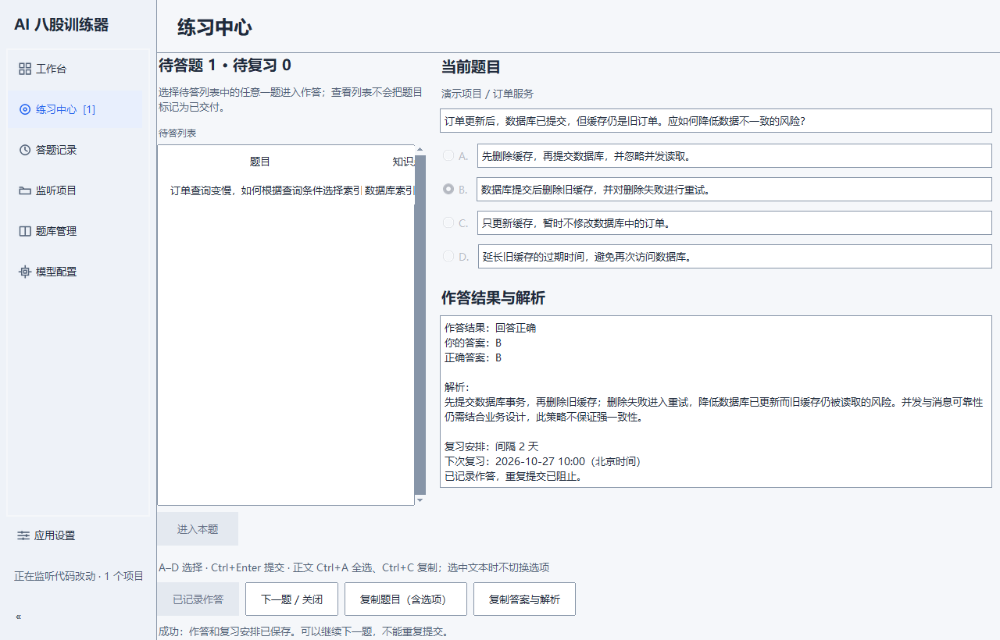

# AI 八股训练器

**把日常代码改动，变成贴近项目的面试练习。**

AI interview practice from your code changes.

面向正在写项目、准备技术面试的开发者：监听项目变化，匹配题库知识点，生成贴近代码场景的 AI 情景题；作答后查看解析，按计划复习。

**[下载 Windows 安装版 · v0.4.2](https://github.com/bugan9527-tech/bagu-trainer/releases/download/v0.4.2/BaguTrainer-0.4.2-windows-x64-Setup.exe)** · [便携 ZIP](https://github.com/bugan9527-tech/bagu-trainer/releases/download/v0.4.2/BaguTrainer-0.4.2-windows-x64.zip) · [最新发布与校验文件](https://github.com/bugan9527-tech/bagu-trainer/releases/latest) · [三步上手](#三步上手)

适用于 Windows x64，无需安装 Python。首次使用需要下载题库来源并配置模型 API，模型请求可能产生服务商费用。



*实际桌面界面；截图使用自编演示题与模拟作答结果，不含个人项目、真实学习记录或模型调用。*

`代码改动 → 知识点匹配 → AI 情景出题 → 作答解析 → 间隔复习`

## 三步上手

1. **下载并启动**：下载安装版后启动“AI 八股训练器”。便携用户完整解压 ZIP，再运行 `BaguTrainer.exe`。
2. **准备题库与模型**：在“题库管理”选择来源并构建；在“模型配置”填写 API 信息，测试连接后保存。
3. **添加项目并开始练习**：在“监听项目”添加代码目录并“保存并应用”。程序建立基线后，后续代码改动在匹配到知识点且生成成功时进入“练习中心”。

[详细上手说明](FIRST_USE.md) · [题库来源与许可](interview-banks/README.md) · [AI 出题规则](AI_QUIZ_POLICY.md) · [常见问题](#常见问题)

已有用户升级：正常退出后直接运行新版安装包，保留个人配置和学习记录；不要先完整卸载。详见[升级与卸载说明](WINDOWS_INSTALLER.md)。

## 运行前提与详细说明

<details>
<summary>查看运行前提、数据位置与版本兼容说明</summary>

把日常代码修改变成与当前任务相关的面试练习：监听选定项目的代码变化，匹配题库知识点，
结合来源正文和工作上下文生成四选一情景题，作答后查看解析并记录掌握度与复习计划。

所有新题必须由 AI 生成；模型不可用、正文不足或输出不合格时提示失败与重试，不展示离线回退题。
复习可复用此前 AI 生成的题目；旧离线题和来源不明快照不再交付，已有作答记录与统计保留。
新题还须通过上下文/来源引用校验及单独的 AI 关联审核。正常生成通常需要两次模型请求，
共用配置的超时预算；服务商可能分别计费，失败不会自动循环调用。流程和限制见 [AI 出题规则](AI_QUIZ_POLICY.md)。

这是一个独立的 Windows 桌面程序：常驻侧栏与右侧工作区承载工作台、练习中心、答题记录、监听项目、题库管理、模型配置和应用设置七个页面。

**普通用户推荐 Windows x64 安装版 `Setup.exe`**：中文安装向导、当前用户安装，默认无需管理员权限，
可选桌面快捷方式。默认程序目录为 `%LOCALAPPDATA%\Programs\BaguTrainer`，个人数据继续在
`%LOCALAPPDATA%\BaguTrainer`；升级和修复保留数据；主动完整卸载清除受管数据与本机 Windows 凭据。
无需安装 Python、Git、PowerShell 或配置 MCP。安装、升级及卸载见 [安装器说明](WINDOWS_INSTALLER.md)。

**便携 ZIP 是另一个下载选项**：完整解压后双击 `BaguTrainer.exe`，保留旁边的 `_internal`。
两种发行共用用户数据与单实例规则；便携使用说明见 [PORTABLE_README.md](PORTABLE_README.md)。
当前产物未签名；自动流程只生成草稿，公开发布需维护者明确操作。

**首次使用需要先构建题库并配置模型。** 发布包不附带第三方完整题库或人工验证
离线回退题；本地构建和来源说明见 [题库发布与构建](QUESTION_BANK.md)。

每次启动直接进入同一个正式工作台，完整显示七项侧栏，不再打开独立首次使用向导。
首次使用在“题库管理”“模型配置”“监听项目”页完成准备，没有强制先后顺序。
准备齐全后在原窗口启用监听与练习；恢复有效配置时显示本机配置恢复提示，并提供查看数据目录和修改配置入口。
模型页只显示 Key 来源类型，输入框不回填真实 Key；恢复与浏览设置不自动测试、迁移或清除数据。
详见 [首次使用与恢复说明](FIRST_USE.md)。

</details>

## 安装版、便携版与源码版

### 安装版（普通用户推荐）

打开 [Release 页面](https://github.com/bugan9527-tech/bagu-trainer/releases)，在 Assets 下载
`BaguTrainer-<版本>-windows-x64-Setup.exe` 和同名 `.sha256`，核对摘要后双击安装，
再从开始菜单启动。也可选择 `BaguTrainer-<版本>-windows-x64.zip` 及其校验文件。
不要把 GitHub 自动附带的 Source code ZIP 当作桌面应用。
普通用户从正式 Release 的 Assets 下载安装包；维护者工作流产生的草稿与正式发布分开。
首次启动直接显示工作台，在题库管理、模型配置、监听项目侧栏页完成准备。无需配置 MCP。
配置、题库和学习记录位于 `%LOCALAPPDATA%\BaguTrainer\`，升级时保留该目录。

默认程序目录为 `%LOCALAPPDATA%\Programs\BaguTrainer\`。安装器的中文安装向导只负责安装程序；
启动应用后的使用准备都在工作台内完成。升级或同版修复前正常退出程序，再运行对应 Setup；
**主动完整卸载会清除受管数据及本机凭据**，不能把卸载作为保留数据的升级或搬家步骤。

### 便携版

下载 `BaguTrainer-<版本>-windows-x64.zip` 及同名 `.sha256`，核对摘要后完整解压，
双击其中的 `BaguTrainer\BaguTrainer.exe`。保留旁边的 `_internal` 和 `BaguCleanup.exe`，不要只复制主 EXE。
在下文三个侧栏页完成准备。升级时正常退出，完整解压新版到新目录，再运行新 EXE；
默认仍使用同一份用户数据，移动程序后重新启用登录自启动。详见 [便携说明](PORTABLE_README.md)。

### 源码版（开发者）

在 Windows 上使用带 Tcl/Tk 的 Python 3.10 或更高版本。克隆仓库，或下载源码 ZIP 解压，
在项目根目录安装依赖并启动；源码 ZIP 本身不是可双击运行的桌面发布包。

```powershell
git clone https://github.com/bugan9527-tech/bagu-trainer.git
cd bagu-trainer
python -m venv .venv
.\.venv\Scripts\python.exe -m pip install -r requirements.txt
.\.venv\Scripts\python.exe -B scripts/start_desktop.py
```

下载源码 ZIP 的用户直接在解压后的项目根目录执行从 `python -m venv` 开始的命令。
无需激活虚拟环境；依赖安装、启动和后续命令使用同一个解释器。源码版也直接进入工作台，
默认与安装版、便携版共用 `%LOCALAPPDATA%\BaguTrainer\`，不会自动读取源码旁的旧配置。

### 发布与验证状态

维护者可在 Actions 运行 **Windows x64 installer and portable draft**，填写与源码版本一致的 tag。
工作流从同一干净提交、同一生产目录构建 ZIP 和 Setup，执行源码/实际 EXE/冻结与安装验收，
分别核对 SHA-256 后上传草稿 Release 和脱敏报告。
工作流进入默认分支后才有手动按钮；PR 自动检查只构建和测试，不创建 Release。
流程、权限及失败重跑见 [发布说明](WINDOWS_PORTABLE.md)。
上述流程是发布门禁的要求，不代表当前版本已全部通过。
功能状态见 [改版进度](UI_REDESIGN_PROGRESS.md)，交付以对应版本、提交和实际报告为准。

[历史验证记录](VALIDATION.md) 包含旧向导流程、v0.3.0 构建及 0.1.0 → 0.2.0 隔离夹具结果，
其中旧版“卸载保留数据”不适用于 0.4.0。0.4.0 本地产物路径修复的工作区证据
`validation/artifact-path-fix-20261025/RESULTS.md`（未随仓库或发布包分发）记录 148 项相关回归通过，
但完整冻结 UI 验收仍报 `No acceptance milestones completed`，不能标为完整发布验收通过。
当前开发机已装 Python/Git，
禁用 PATH 不代表已完成全新系统验收。另附 [干净 Windows 验收包和流程](CLEAN_WINDOWS_ACCEPTANCE.md)。
0.4.0 的 [真实 Setup 生命周期验收](INSTALLED_LIFECYCLE_ACCEPTANCE.md) 已补齐脚本和操作说明，
但当前六项真实安装场景均未执行，脚本回归或只读预检不等于真实安装通过。

## 功能与边界

- 通过主窗口添加监听项目；比较监听开始后的文件快照，即使改动已自动提交到 Git 也能检测。
- 文件稳定约 15 秒后匹配知识点，新题更新练习中心待答徽标，不抢走当前阅读或输入页面；人工修改也可能触发。
- 在内嵌练习中心选择 A–D、提交答案、查看解析，作答及复习计划保存到本地 SQLite。
- 切页保留当前题目、未提交选择和任务状态；Ctrl+R 进入练习中心（表单输入时不拦截）。待答列表只读，明确进入某题时才交付该题。
- 主窗口“答题记录”按每次作答回顾历史，支持正误、项目和知识点/题干关键词筛选，每页 20 条；已移除项目及旧题库的题目仍从快照查看。时间按本机时区显示。
- 历史详情可“重新练习本题”：复用合格的 AI 快照，不调用模型，进入练习中心；同一来源作答未完成的重练复用题号，提交后新增一次记录。旧快照缺失字段或不符合准入规则时解释原因并禁用重练。
- 普通切页不停止监听、不重建基线；项目实际保存后串行应用，未变化项目基线保留。题库构建、模型测试和保存不因隐藏页面取消。

程序不保证每次改动都有题。未匹配知识点、缺少可靠来源、模型接口不可用或上下文重复时，
可能没有题目。代码改动稳定只是触发时机的近似判断，不能精确识别 AI 任务何时结束。

## 环境要求

以下 Python 和命令行步骤供开发者从源码运行；下载安装版或便携版的普通用户无需执行。

| 项目 | 要求 |
| --- | --- |
| 操作系统 | Windows 桌面及当前用户登录自启动 |
| Python | 仅源码运行需要 3.10 或更高及 Tcl/Tk；便携版已内置运行库 |
| 下载题库 | 桌面内置 HTTPS ZIP 下载和构建，无需 Git 或外部构建命令 |
| 模型接口 | 支持 `/chat/completions`、Bearer Key 认证和文本 JSON 输出的兼容接口 |
| 网络 | 首次安装依赖、下载来源及调用远程模型时需要连接相应服务 |

运行时依赖见 [requirements.txt](requirements.txt)，测试依赖见
[requirements-dev.txt](requirements-dev.txt)，便携包构建依赖见
[requirements-build.txt](requirements-build.txt)。

历史 MCP 配置、演示和重复生成物的清理范围及保留理由见 [清理记录](CLEANUP_REPORT.md)。

## 在工作台完成准备（三种运行方式通用）

### 1. 题库管理

打开侧栏“题库管理”，从 [来源清单](interview-banks/README.md) 选择来源并阅读许可声明，
点击“构建 / 重新构建”。
程序通过 HTTPS 下载清单固定 commit 的 ZIP，安全解压后依次完成提取、导入、标签和概念构建。
页面显示阶段进度，可设置“任务总时限（秒）”、点击“取消构建”或“仅重试失败项”；不抓取 GitHub Issues。

源码版和便携版都将本机文件放入 `%LOCALAPPDATA%\BaguTrainer\`；下文运行数据相对该目录。
成功后使用 `data/banks/<版本>/` 下的完整题库，通过原子指针切换；已有 `data/questions.json`
和学习数据库保持原样。已有可用题库的用户可跳过下载。流程、接口及发布范围见
[QUESTION_BANK.md](QUESTION_BANK.md) 和 [BANK_BUILD.md](BANK_BUILD.md)。

### 2. 模型配置

打开侧栏“模型配置”，填写：

| 字段 | 填写方式 |
| --- | --- |
| 接口地址 | 服务商提供的 API 基础地址，通常包含 `/v1`，不包含末尾的 `/chat/completions` |
| 模型名称 | 服务商为你的账户提供的实际模型标识 |
| API Key | 该接口的访问 Key；留空可沿用已有 Key，输入框不回填明文 |
| 超时（秒） | 大于 0 且不超过 120 秒；新题的生成与关联审核共用这一预算 |

程序会在接口地址后追加 `/chat/completions`。主动点击“测试连接”会在后台发送一个小请求，
可能产生服务商计费；测试成功后点击“保存”。测试失败后可点击“重新测试”，进行中可点击“取消测试”。
Key 写入现有 Windows 凭据管理器并回读确认，配置文件不保存 Key 明文。连接成功不保证模型
一定能生成符合要求的题目。修改任一表单参数后需要重新测试，保存后即时生效。

无需先复制 `config.example.json`。在模型配置页保存时会在用户数据目录创建
`config.json`。`config.example.json` 中的空 `trae_home` 表示使用当前用户的 `.trae-cn`，
空 `project_roots` 会使工作台显示准备未完成，需在“监听项目”页显式添加项目；相对 `db_path`
按用户数据目录解析，与安装目录和终端所在目录无关。其他项目也可通过主窗口添加。
如已有环境变量 `BAGU_LLM_API_KEY`，它优先于凭据管理器中的 Key；排查旧 Key 或迁移时
参见 [KEY_MIGRATION.md](KEY_MIGRATION.md)。

### 3. 监听项目

打开侧栏“监听项目”，点击“添加项目文件夹”选择实际代码目录，再点击“保存并应用”。
目录失效时可“移除选中目录”后重新添加有效目录并保存，至少保留一个可读取的项目。
三个条件齐全后会在原窗口加载引擎；未刷新或加载失败时，在“工作台”点击“重新检查 / 加载引擎”。

### 4. 在内嵌练习中心作答

1. 在监听项目中修改并保存与题库知识点相关的源码，等待文件稳定约 15 秒及后续匹配、模型请求。
2. 生成成功后只更新待答徽标及提示，不自动切页或打开独立题目窗口。打开“练习中心”，
   选中待答列表中的题目并点击“进入本题”；也可从工作台“继续答题 (Ctrl+R)”恢复练习。
3. 选择 A–D，点击“提交答案”，在同一页的“作答结果与解析”查看判分、正确答案和解析。
   之后可点击“下一题 / 关闭”。答题记录和复习计划保存到本机数据库。

添加项目或启动程序时会先建立基线，旧改动不会立即当作新任务。模型请求和扫描还会增加等待时间。
监听不再依赖未提交的 Git 差异，避免自动提交或过大的历史差异掩盖新修改。
未命中知识点时，窗口会显示题库数量及“未调用 AI”；日志记录匹配、重复跳过和生成结果的数量，不记录代码正文。
题库构建同时导入问句和普通知识点标题；早期仅导入问句而题量很少的本机题库，需要重新构建。
工作台“暂停全部监听”/“恢复全部监听”作用于全部项目，暂停时仍可主动练习已有题目。
快捷键：`Ctrl+R` 进入练习中心；练习阅读区 `A`–`D` 选择、`Ctrl+Enter` 提交，表单输入时不拦截。
关闭主窗口即开始安全退出，取消可取消任务并等待写入完成；再次运行启动入口会唤起已有实例。

启动的准备检查不下载题库、不自动测试模型；就绪后才加载引擎。缺项或引擎加载失败时仍保留七页主窗口，
登录自启动使用同一个最小化窗口，可从任务栏恢复。说明见 [首次使用与修复](FIRST_USE.md) 和 [启动流程](STARTUP.md)。

### 缺配置、空题库与损坏配置的恢复

- 缺题库：在“题库管理”选择来源并“构建 / 重新构建”。删除最后一个来源后仍留在主窗口，
  监听与练习停用；重新构建后恢复。删除时确认的关联记录不会因重新下载而自动恢复。
- 缺模型或 Key：在“模型配置”补全参数，主动“测试连接”成功后“保存”。环境变量中的旧 Key 需先修正。
- 缺项目或目录失效：在“监听项目”修正目录并“保存并应用”，再查看工作台准备状态。
- `config.json` 损坏或不可读：从“应用设置”查看个人数据目录，退出程序并备份文件，
  修复 JSON 格式或权限后重启。程序不会用默认配置覆盖坏文件；不要删除唯一的数据副本来绕过检查。
- 引擎加载失败：检查工作台提示及 `logs/desktop.log`，修复依赖、目录或权限后点“重新检查 / 加载引擎”。

## 可选：登录后自动启动

主窗口“登录自启动”菜单可直接启用或取消。便携版快捷方式指向当前 EXE；移动程序后重新启用即可。
也可执行 `BaguTrainer.exe --install-startup` / `--uninstall-startup`。

先完成题库、模型配置并确认能正常打开桌面窗口。安装脚本优先使用项目中的
`.venv/Scripts/python.exe`，不存在时才使用 PATH 中的 `python`：

```powershell
powershell.exe -NoProfile -ExecutionPolicy Bypass -File .\scripts\install-startup.ps1
```

它会在当前用户的 Startup 文件夹创建快捷方式，并立即最小化启动程序。
这是用户登录后的启动，不是系统服务。取消自启动：

```powershell
powershell.exe -NoProfile -ExecutionPolicy Bypass -File .\scripts\install-startup.ps1 -Uninstall
```

若使用其他虚拟环境，可给安装命令加 `-PythonExe "你的环境目录\Scripts\python.exe"`。
取消后仍在运行的桌面程序需自行退出；学习记录保留。移动项目或 Python 环境后需要重新安装快捷方式。
更多说明见 [DESKTOP_MODE.md](DESKTOP_MODE.md)。

### 换目录或换电脑

在新位置重新创建 `.venv` 并安装依赖，不要直接复制旧虚拟环境。
源码和便携版在同一 Windows 用户下共用 `%LOCALAPPDATA%\BaguTrainer\`，换程序目录后学习记录仍在。
旧版曾将配置和数据放在项目旁。先退出新旧程序，再从命令行显式迁移；当前工作台没有“迁移旧数据…”按钮。
安装版在安装目录、便携版在解压后的 `BaguTrainer` 目录执行第一条；源码版在项目根目录执行第二条，按运行方式择一：

```powershell
.\BaguTrainer.exe --migrate-from "D:\旧目录\bagu trainer"
.\.venv\Scripts\python.exe -B scripts/start_desktop.py --migrate-from "D:\旧目录\bagu trainer"
```

迁移复制并校验数据，旧目录保留；目标已有配置、题库或学习数据时拒绝覆盖。旧明文 Key 必须确认写入
Windows 凭据管理器后才启用配置。迁移成功后仍进入同一工作台检查准备状态。
换电脑需要在退出程序后另行备份用户数据，
核对监听项目绝对路径、重新保存 Windows 凭据并更新自启动；凭据不随目录复制。

## 升级、修复与完整卸载

安装版正常退出后运行新版或同版 Setup，在原安装位置升级/修复，保留用户数据和凭据。
便携版退出后使用新版完整目录；源码版更新代码、依赖后从同一用户数据目录启动。
三种方式均不要通过“先完整卸载”来升级保留数据。

主动完整卸载：打开“应用设置”，点击“卸载应用并清除全部数据…”，核对范围后点击
“确认退出并进入完整卸载”，在独立工具中点击“确认完整卸载 / 重试”。安装版也可从 Windows
“已安装的应用”进入卸载。完整卸载清除受管题库、历史、配置、日志及本机 API 凭据；
安装版和便携版可能共用这些数据，其他副本也会受影响。已确认归属的自定义学习库也属于清理范围。
清理不整体删除监听项目、源码仓库、共用目录或其他副本的程序，不代表吊销服务商后台 Key。
失败保留程序或重试入口，但不保证恢复已经清除的数据。源码版保留源码和虚拟环境；
只删除便携程序目录或源码目录不等于完整卸载。详见 [安装与卸载](WINDOWS_INSTALLER.md)。

## 数据与隐私

- 模型出题会向你配置的接口发送经过筛选和脱敏的项目上下文片段及题库来源正文。
  选择服务商时需要考虑自己项目的数据使用要求。
- 文件采集受项目白名单及敏感文件排除规则限制；会话摄取默认关闭。
- 新保存的 API Key 进入系统凭据管理器，本机配置不保存新 Key 明文。
- 用户数据根目录为 `%LOCALAPPDATA%\BaguTrainer\`；学习记录默认位于其 `data/trainer.db`，
  进程运行文件在 `runtime/`，滚动日志在 `logs/`。程序目录可只读。
- 本机配置、学习数据库、运行认证信息及完整题库均已通过 `.gitignore` 排除。
  手工制作发布附件时仍需遵守 [题库发布范围](QUESTION_BANK.md)。

## 常见问题

| 现象 | 排查方式 |
| --- | --- |
| 找不到 `python` 或 `git` | 确认对应程序已安装且位于 PATH，重新打开终端后检查版本 |
| 缺少 `keyring` | 用启动程序的同一解释器执行 `-m pip install -r requirements.txt` |
| `tkinter`、Tcl/Tk 初始化失败 | 为当前 Python 安装 Tcl/Tk 支持；用 `.\.venv\Scripts\python.exe -B scripts/start_desktop.py --check-runtime` 检查窗口环境 |
| 提示题库不存在或已删除最后来源 | 在“题库管理”选择来源并“构建 / 重新构建”，再到工作台检查就绪状态 |
| 来源下载失败 | 检查 HTTPS 网络及系统代理；瞬时错误会自动重试，也可在窗口重新尝试 |
| HTTP 401 / 404 / 429 | 分别检查 Key/授权、基础地址与模型路径、额度及请求限制；环境变量中的旧 Key 可能覆盖新保存的 Key |
| 模型连接超时或题目生成失败 | 检查接口网络、超时设置、模型标识，以及是否支持要求的 JSON 输出 |
| 修改代码后没有待答题 | 查看练习中心徽标；确认监听未暂停、修改发生在基线建立之后，检查项目范围、来源正文及模型状态 |
| 导入提示题量减少超过 5% | 数据保护已生效；在独立目录构建新来源，保留原题库和学习数据 |

## 开发与验证

历史安装、来源下载及桌面运行记录见 [历史验证记录](VALIDATION.md)，其版本和未验证范围须一并阅读。
本次文档核对依据 0.4.0 源码，不新增实际安装、模型连接、迁移或卸载验收结论。

安装开发依赖，执行不依赖本机完整题库的发布流程测试：

```powershell
.\.venv\Scripts\python.exe -m pip install -r requirements-dev.txt
# 先按 WINDOWS_PORTABLE.md 在新目录完成构建；构建和验收必须使用同一个目录。
$buildOutput = 'output/填写本次实际构建目录'
$evidence = "validation/portable-$(Get-Date -Format yyyyMMdd-HHmmss)"
.\.venv\Scripts\python.exe scripts/run_release_tests.py --output-dir $buildOutput --output "$evidence/release-tests.xml"
```

这些测试覆盖来源选择、默认不联网抓取 Issues、缺失题库提示、无旧数据的首次构建，
以及中文和空格目录中的配置定位与自启动解释器选择。自启动测试只写临时快捷方式，不安装实际登录自启动。
`tests/` 中匹配器的历史评估通过 `BAGU_TEST_BANK_ROOT` 显式指定项目外只读基准；普通单元测试使用临时合成题库，详见 [验证范围](VALIDATION.md)。内容链路的归档读取/AI-only 测试现使用自编合成夹具，不再依赖未分发的离线归档。
发布测试逐模块运行于独立进程，完整保留失败和跳过结果，不自动重试；单元检查使用 `python -m pytest tests -q -W error`。便携包需先构建；旧版本、源码指纹不符、缺包或缺少 ZIP/SHA-256 附件会在测试启动前失败，不再隐式验收 `dist` 中的旧包。构建和验收统一使用 `--output-dir`，也兼容 `BAGU_PORTABLE_OUTPUT_DIR`、`BAGU_PORTABLE_BUNDLE` 和 `BAGU_PORTABLE_ARCHIVE`。JUnit 旁的 `.artifact.json` 记录实际路径、版本及摘要；已有输出和验证证据拒绝覆盖。完整命令见 [Windows 构建与验证](WINDOWS_PORTABLE.md)。验证前将 `BAGU_USER_DATA_DIR` 指向独立目录；测试只写临时配置和数据库。

| 路径 | 用途 |
| --- | --- |
| `bagu_trainer/` | 桌面、匹配、出题和学习记录逻辑 |
| `scripts/` | 桌面入口、自启动和本地题库构建脚本 |
| `data/` | 本机旧版数据可能保留于此；新运行数据默认在用户目录，不随源码发布 |
| `interview-banks/` | 可发布的来源清单；新下载的上游副本在用户目录 |
| `release_tests/` | 源码发布与首次构建测试 |
| `tests/` | 完整功能与历史题库回归 |

## 许可与第三方内容

本项目原创源码及文档采用 [MIT License](LICENSE)。允许使用、修改、分发及商用，
包括在闭源产品中使用；分发代码或其重要部分时须保留版权声明和许可证文本。
上游题库的许可证和版权声明独立适用，详见 [来源清单](interview-banks/README.md)。
源码发布方案不包含第三方完整题库；本地下载、使用或后续再分发时需核对相应条款。

## 桌面视觉规范

统一主题、中文字体、间距和按钮规范见 [UI_DESIGN.md](UI_DESIGN.md)，新增运行组件声明见 [THIRD_PARTY_NOTICES.md](THIRD_PARTY_NOTICES.md)。源码运行前执行 `python -m pip install -r requirements.txt`；便携包已包含主题依赖。
窗口缩放、长文本、键盘和实际显示覆盖范围见 [UI_DISPLAY.md](UI_DISPLAY.md)。可用 `python scripts/check_ui_display.py` 生成隔离窗口截图供人工检查；Tk 模拟缩放不代表原生 Windows 对应比例的验收。
